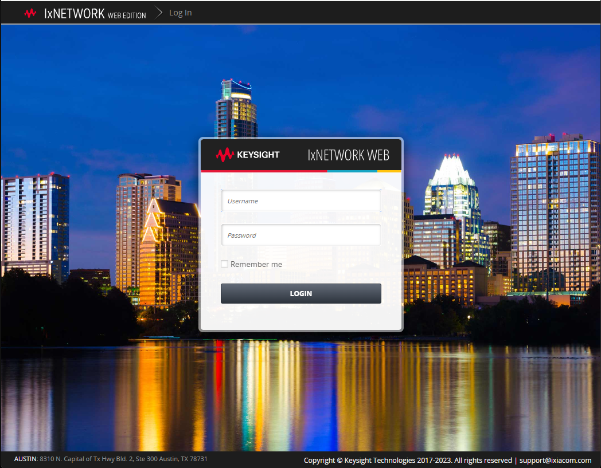

# cookiecutter-ixnetwork-apiserver
cookiecutter template to spin up ixnetwork apiserver as a docker container

## How to

```
$ uv venv .venv
Using CPython 3.13.7
Creating virtual environment at: .venv
Activate with: source .venv/bin/activate
$ source .venv/bin/activate
(.venv) $ uv pip install cookiecutter
Resolved 21 packages in 130ms
Installed 21 packages in 29ms
 + arrow==1.4.0
 + binaryornot==0.6.0
 + certifi==2026.10.19
 + charset-normalizer==3.5.2
 + click==8.5.0
 + cookiecutter==2.7.1
 + idna==3.20
 + jinja2==3.1.6
 + markdown-it-py==4.2.0
 + markupsafe==3.0.4
 + mdurl==0.1.2
 + pygments==2.21.0
 + python-dateutil==3.0.0
 + python-slugify==9.1.3
 + pyyaml==6.0.3
 + requests==2.34.2
 + rich==15.0.0
 + six==1.17.0
 + text-unidecode==1.3
 + tzdata==2026.5
 + urllib3==2.8.0
(.venv) $ cookiecutter .
  [1/8] IXNETWORK_API_SERVER_IMAGE (ixnetworkweb_11.10.2508.146_image:latest): 
  [2/8] IXNETWORK_API_SERVER_HOST_PORT (443): 
  [3/8] IXN_USERNAME (admin): 
  [4/8] IXN_PASSWORD (admin): 
  [5/8] project_name (ixNetwork API Server Docker Compose): api in wsl
  [6/8] project_slug (api-in-wsl): 
  [7/8] project_short_description (A cookiecutter template for IxNetwork API Server): 
  [8/8] first_version (0.1.0): 
(.venv) $ cd api-in-wsl/
(.venv) api-in-wsl$ ls
docker-compose.yaml
(.venv) api-in-wsl$ docker compose up -d
[+] up 4/4
 ✔ Network api-in-wsl_default          Created                                                                                                                                                                        0.0s
 ✔ Volume api-in-wsl_ixnetwork-web-run Created                                                                                                                                                                        0.0s
 ✔ Volume api-in-wsl_ixnetwork-web-tmp Created                                                                                                                                                                        0.0s
 ✔ Container ixnetwork-web             Started                                                                                                                                                                        0.3s
(.venv) api-in-wsl$ 
(.venv) api-in-wsl$ docker compose down
[+] down 2/2
 ✔ Container ixnetwork-web    Removed                                                                                                                                                                                                                           10.5s
 ✔ Network api-in-wsl_default Removed     
 (.venv) api-in-wsl$       
```

Check out the service is running with GUI when the service is up:

